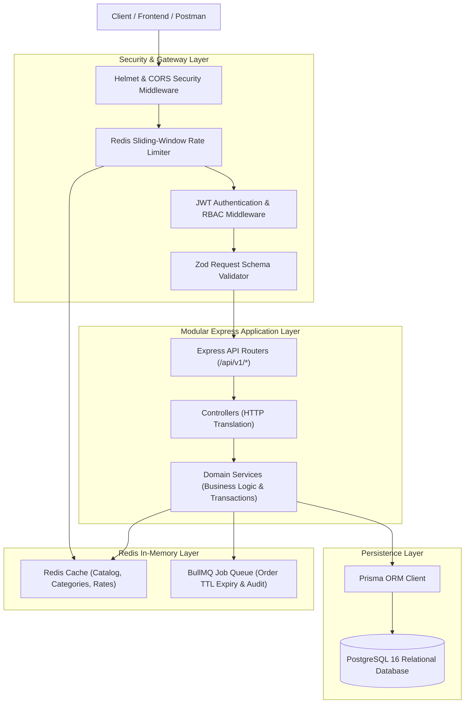
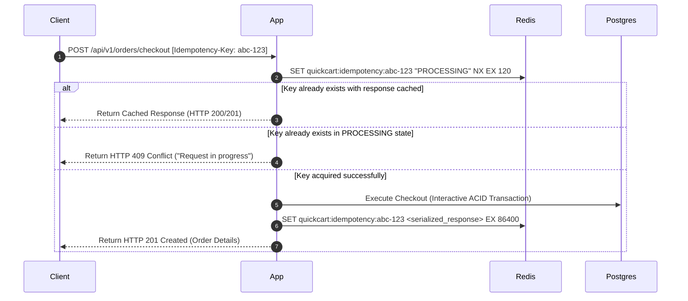
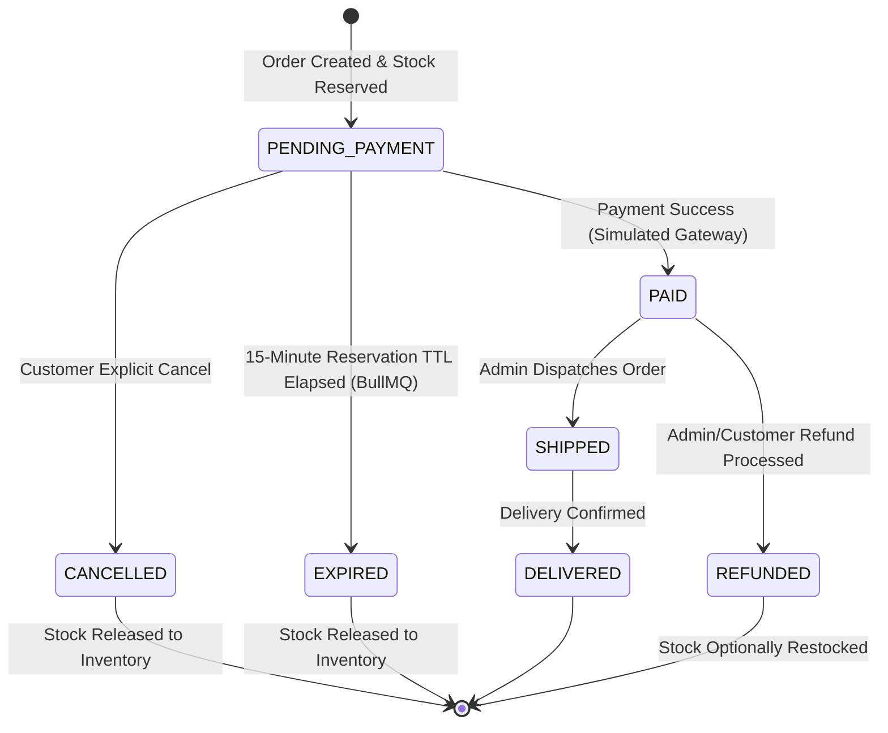

# QuickCart System Architecture & Engineering Blueprint

## 1. Executive Summary & System Objectives

**QuickCart** is a backend-focused, production-grade e-commerce RESTful API designed to address real-world distributed systems challenges: concurrency, inventory race conditions, strict financial consistency, idempotency, and high-performance caching.

### Core Architectural Pillars
- **Strict Data Consistency:** Financial and inventory transactions are ACID-compliant; double-spending and overselling are mathematically prevented at the database layer.
- **Server-Side Price Authority:** Zero trust in client-side data. Product pricing, discounts, and order subtotals are computed dynamically from authoritative database records.
- **Performance & Scalability:** Cache-aside pattern via Redis reduces database load for read-heavy catalog operations by over 80%.
- **Resilience & Fault Tolerance:** Rate limiting, circuit-breaking patterns for simulated third-party integrations, and automated background reconciliation.
- **Idempotent Operations:** Critical mutating operations (order checkout, payment processing) require unique idempotency keys to safely tolerate network retries.

---

## 2. High-Level Architecture Diagram



---

## 3. Modular Layered Architecture (N-Tier Clean Architecture)

The codebase strictly adheres to the **Separation of Concerns (SoC)** principle, isolating HTTP transport from domain rules and persistence mechanisms.

```
quickcart/
├── src/
│   ├── app.js                   # Express application setup & middleware registration
│   ├── server.js                # Server entry point, graceful shutdown & port listener
│   ├── config/                  # Validated environment configuration & constant singletons
│   ├── constants/               # System enums, error codes, HTTP status constants
│   ├── middlewares/             # Auth, RBAC, error handling, rate limiter, request logger
│   ├── modules/                 # Modular feature domains
│   │   ├── auth/                # Authentication, token rotation, registration, login
│   │   ├── categories/          # Category hierarchy management
│   │   ├── products/            # Catalog, inventory reads, search, filtering
│   │   ├── cart/                # Shopping cart, server-side item resolution
│   │   ├── orders/              # Checkout, atomic transaction orchestration
│   │   ├── payments/            # Simulated gateway, state machine, webhook handling
│   │   └── health/              # Liveness and readiness health checks
│   │       ├── *.routes.js      # URL routes & middleware binding
│   │       ├── *.controller.js  # HTTP request extraction & response serialization
│   │       ├── *.service.js     # Domain rules & transactional business logic
│   │       ├── *.repository.js  # Raw data access / Prisma ORM queries
│   │       └── *.validation.js  # Zod input/output schemas
│   ├── jobs/                    # BullMQ job queues, workers, and scheduled processors
│   ├── utils/                   # Idempotency helpers, response formatters, logger
│   └── lib/                     # Singletons: Prisma client, Redis client, BullMQ connection
```

### Layer Responsibilities
1. **Router Layer:** Maps HTTP endpoints and binds route-specific validation and authentication middleware.
2. **Controller Layer:** Parses HTTP headers, query parameters, path variables, and body payloads; invokes the service layer; formats responses using the standardized API envelope.
3. **Service Layer (Pure Domain Logic):** Contains all business logic (e.g., verifying stock availability, computing discounts, enforcing idempotency). No HTTP-specific objects (`req`, `res`) are permitted here, ensuring testability.
4. **Data Access / Repository Layer:** Encapsulates Prisma queries and raw SQL transactions.
5. **Background Workers (BullMQ):** Decouples asynchronous and delayed processing (e.g., releasing expired order reservations after 15 minutes).

---

## 4. Concurrency & Inventory Race Condition Strategy

### The Problem: Check-Then-Act Race Condition
In high-concurrency scenarios (e.g., flash sales), multiple users may attempt to purchase the last unit of an item simultaneously.
A naive approach reads the stock first:
```sql
-- Step 1 (Thread A & B both read stock = 1)
SELECT stock FROM products WHERE id = 'prod-123';

-- Step 2 (Both threads verify 1 >= 1, and execute write)
UPDATE products SET stock = stock - 1 WHERE id = 'prod-123';
-- Result: Stock becomes -1 (Overselling / Stock Corruption)
```

### Concurrency Strategies Evaluated for QuickCart

| Strategy | Mechanism | Pros | Cons | Decision |
| :--- | :--- | :--- | :--- | :--- |
| **Pessimistic Locking** (`SELECT ... FOR UPDATE`) | Row-level exclusive lock during transaction | Prevents any concurrent read/write until committed | High lock contention; throughput bottleneck; deadlock risk | Used selectively for complex multi-product atomic batches |
| **Optimistic Concurrency Control (OCC)** | Version counter (`WHERE id = ? AND version = ?`) | Non-blocking; excellent for low-write contention | High retry overhead when multiple clients compete | Ideal for product metadata edits by admins |
| **Atomic Conditional Update** | Single atomic SQL statement with guard condition | Highest throughput; zero lock wait time; ACID compliant | Requires raw SQL or custom Prisma query | **Primary Strategy for Checkout** |

### Selected Concurrency Implementation: Atomic Conditional Update
Stock deduction is executed using an atomic condition at the database engine level:
```sql
UPDATE "Product"
SET "stock" = "stock" - $1, "updatedAt" = NOW()
WHERE "id" = $2 AND "stock" >= $1
RETURNING "id", "stock";
```
If the number of affected rows is `0`, the service instantly detects an inventory shortage and aborts the transaction with an explicit `409 Conflict` (Out of Stock), guaranteeing zero overselling.

---

## 5. Idempotency & Order State Machine

### The Double-Submit Vulnerability
Network timeouts or impatient users can trigger duplicate checkout or payment requests. Without idempotency protection, this results in duplicate orders and double debits.

### Idempotency Flow via `Idempotency-Key`
Every order creation and payment request requires an `Idempotency-Key` header (UUIDv4):



### Order Lifecycle State Machine
Orders transition strictly according to the following deterministic state transitions:



---

## 6. Caching Architecture & Invalidation

QuickCart adopts a **Cache-Aside (Lazy Loading)** model backed by Redis:

1. **Read Request:** Check Redis for key `quickcart:product:{id}`.
   - *Hit:* Return cached product directly (sub-5ms response).
   - *Miss:* Query PostgreSQL via Prisma, write result to Redis with a TTL (e.g., 300 seconds), and return.
2. **Write / Invalidation:** When an admin modifies or deletes a product:
   - Perform the database write.
   - Invalidate specific item cache: `DEL quickcart:product:{id}`.
   - Invalidate related list cache keys: `DEL quickcart:products:catalog:*`.
3. **Cache Stampede Prevention:** Hot keys utilize background refreshing or short mutex locks during re-population to avoid thundering-herd spikes on the primary database.

---

## 7. SDE Portfolio & Interview Talking Points

When presenting QuickCart in engineering interviews, emphasize these concrete system design decisions:

1. **Why PostgreSQL over MongoDB?**
   - E-commerce is fundamentally relational. Orders, Order Items, Products, Inventory, and Users require strict referential integrity (`FOREIGN KEY` with `CASCADE` or `RESTRICT`).
   - ACID transactions ensure that inventory updates and order creation succeed or fail together. Distributed document stores introduce eventual consistency complications that lead to inventory drift.
2. **Why a Modular Monolith over Microservices?**
   - For early-to-mid scale e-commerce, a well-structured modular monolith provides superior operational simplicity: zero network serialization overhead between modules, atomic database transactions without complex two-phase commits (2PC) or Sagas, unified deployment, and instant local reproduction.
   - Boundaries are cleanly enforced via modular folder structures, enabling straightforward extraction into microservices if domain scaling demands it.
3. **Why Server-Side Price Calculation?**
   - Never trust frontend payloads. If a user tampers with the HTTP payload and sends `price: 0.01`, the system ignores it. Prices are strictly determined by querying authoritative product records within the transaction snapshot.
4. **Asynchronous Stock Release via BullMQ vs. Cron Job:**
   - Traditional polling cron jobs (`SELECT * FROM orders WHERE status = 'PENDING' AND createdAt < ...`) perform table scans and induce high database load.
   - BullMQ utilizes Redis sorted sets (`ZADD` with timestamps) to schedule exact delayed jobs (`{ delay: 15 * 60 * 1000 }`), waking up only when a specific order reservation expires to release its stock atomically.
