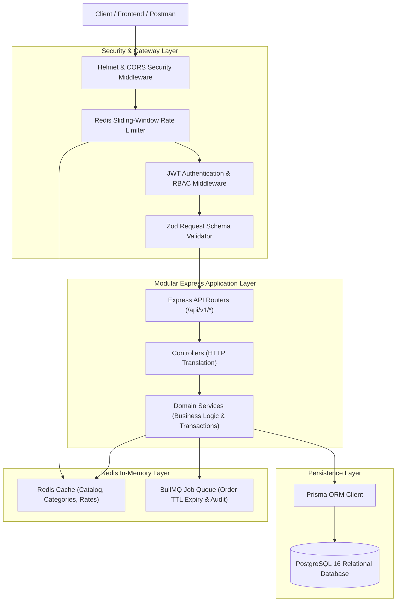
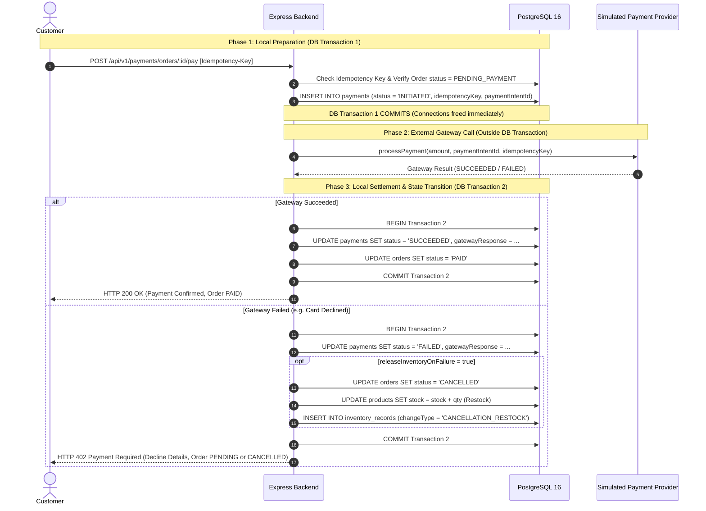
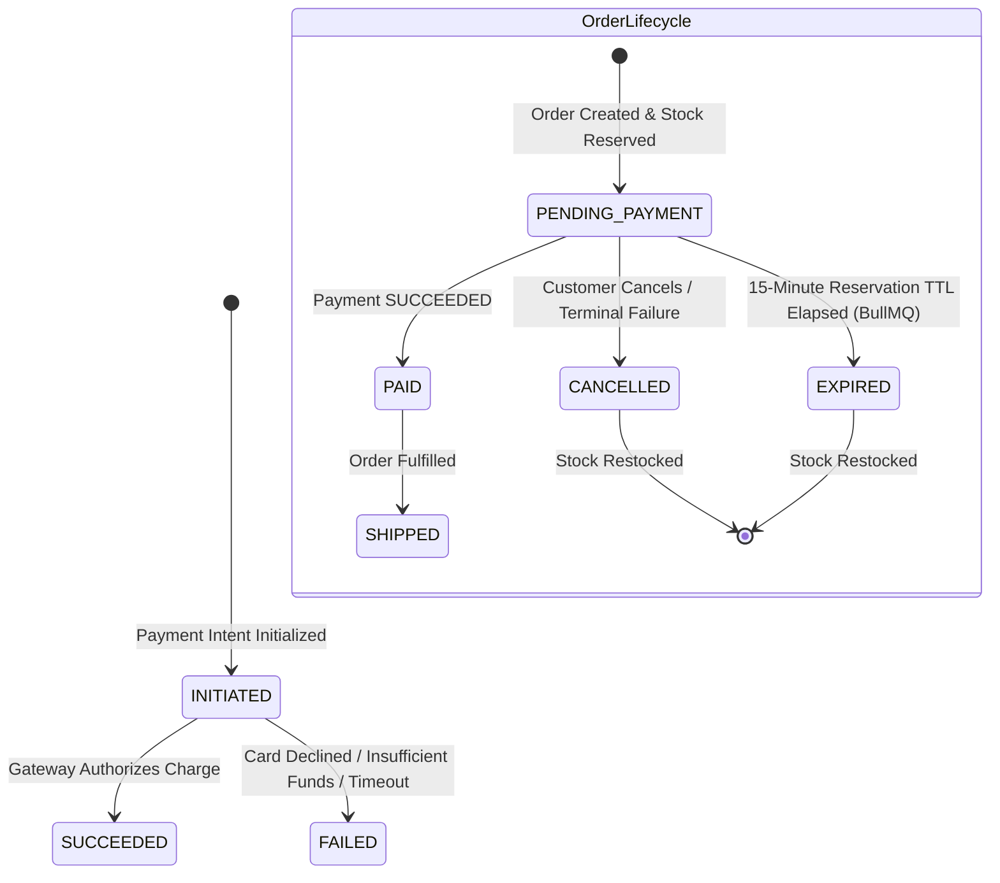

# QuickCart System Architecture & Engineering Blueprint

## 1. Executive Summary & System Objectives

**QuickCart** is a backend-focused, production-grade e-commerce RESTful API designed to address real-world distributed systems challenges: concurrency, inventory race conditions, strict financial consistency, idempotency, and high-performance caching.

### Core Architectural Pillars
- **Strict Data Consistency:** Financial and inventory transactions are ACID-compliant; double-spending and overselling are mathematically prevented at the database layer.
- **Server-Side Price Authority:** Zero trust in client-side data. Product pricing, discounts, and order subtotals are computed dynamically from authoritative database records.
- **Performance & Scalability:** Cache-aside pattern via Redis reduces database load for read-heavy catalog operations by over 80%.
- **Resilience & Fault Tolerance:** Rate limiting, circuit-breaking patterns for simulated third-party integrations, and automated background reconciliation.
- **Idempotent Operations:** Critical mutating operations (order checkout, payment processing) require unique idempotency keys to safely tolerate network retries.

---

## 2. High-Level Architecture Diagram



---

## 3. Modular Layered Architecture (N-Tier Clean Architecture)

The codebase strictly adheres to the **Separation of Concerns (SoC)** principle, isolating HTTP transport from domain rules and persistence mechanisms.

```
quickcart/
├── src/
│   ├── app.js                   # Express application setup & middleware registration
│   ├── server.js                # Server entry point, graceful shutdown & port listener
│   ├── config/                  # Validated environment configuration & constant singletons
│   ├── constants/               # System enums, error codes, HTTP status constants
│   ├── middlewares/             # Auth, RBAC, error handling, rate limiter, request logger
│   ├── modules/                 # Modular feature domains
│   │   ├── auth/                # Authentication, token rotation, registration, login
│   │   ├── categories/          # Category hierarchy management
│   │   ├── products/            # Catalog, inventory reads, search, filtering
│   │   ├── cart/                # Shopping cart, server-side item resolution
│   │   ├── orders/              # Checkout, atomic transaction orchestration
│   │   ├── payments/            # Simulated gateway, state machine, webhook handling
│   │   └── health/              # Liveness and readiness health checks
│   │       ├── *.routes.js      # URL routes & middleware binding
│   │       ├── *.controller.js  # HTTP request extraction & response serialization
│   │       ├── *.service.js     # Domain rules & transactional business logic
│   │       ├── *.repository.js  # Raw data access / Prisma ORM queries
│   │       └── *.validation.js  # Zod input/output schemas
│   ├── jobs/                    # BullMQ job queues, workers, and scheduled processors
│   ├── utils/                   # Idempotency helpers, response formatters, logger
│   └── lib/                     # Singletons: Prisma client, Redis client, BullMQ connection
```

### Layer Responsibilities
1. **Router Layer:** Maps HTTP endpoints and binds route-specific validation and authentication middleware.
2. **Controller Layer:** Parses HTTP headers, query parameters, path variables, and body payloads; invokes the service layer; formats responses using the standardized API envelope.
3. **Service Layer (Pure Domain Logic):** Contains all business logic (e.g., verifying stock availability, computing discounts, enforcing idempotency). No HTTP-specific objects (`req`, `res`) are permitted here, ensuring testability.
4. **Data Access / Repository Layer:** Encapsulates Prisma queries and raw SQL transactions.
5. **Background Workers (BullMQ):** Decouples asynchronous and delayed processing (e.g., releasing expired order reservations after 15 minutes).

---

## 4. Concurrency & Inventory Consistency Strategy

### 4.1 The Problem: Check-Then-Act Race Condition
In high-concurrency scenarios (e.g., flash sales), multiple users may attempt to purchase the last unit of an item simultaneously.
A naive approach reads the stock first:
```sql
-- Step 1 (Thread A & B both read stock = 1)
SELECT stock FROM products WHERE id = 'prod-123';

-- Step 2 (Both threads verify 1 >= 1, and execute write)
UPDATE products SET stock = stock - 1 WHERE id = 'prod-123';
-- Result: Stock becomes -1 (Overselling / Stock Corruption)
```

### 4.2 Concurrency Strategies Evaluated & Trade-off Analysis

| Strategy | Mechanism | Pros | Cons & Trade-offs | Decision in QuickCart |
| :--- | :--- | :--- | :--- | :--- |
| **Serializable Isolation** | PostgreSQL detects rw-antidependencies (SSI) and aborts conflicting txs | Clean theoretical model; prevents all anomalies without explicit locks | Extremely high abort rate (`40001 serialization_failure`) under flash-sale write spikes; requires complex exponential backoff retry loops | Rejected for checkout writes due to excessive retry overhead |
| **Optimistic Concurrency Control (OCC)** | Version counter (`WHERE id = ? AND version = ?`) | Zero lock wait time; non-blocking reads | High retry storms when dozens of clients compete for the last item; only 1 succeeds, all others must retry | Used exclusively for low-contention Admin product edits |
| **Pessimistic Row Locking** (`SELECT ... FOR UPDATE`) | Row-level exclusive lock during transaction | Guarantees transaction reads latest committed state; serializes access | Hold time equals transaction duration; risk of deadlock if items locked in arbitrary order | Combined with global key ordering for multi-item checkouts |
| **Atomic Conditional Update** (`UPDATE ... WHERE stock >= requested`) | PostgreSQL atomic write lock with guard condition in a single statement | Maximum throughput; zero lock wait before update; engine-level serialization | Returns row count 0 on stock exhaustion, triggering immediate transaction rollback | **Primary Engine for Checkout Inventory Reservation** |

### 4.3 Deadlock Prevention via Global Deterministic Key Ordering
When multiple users check out carts containing overlapping sets of products simultaneously:
- **Transaction 1** locks Product A, then attempts to lock Product B.
- **Transaction 2** locks Product B, then attempts to lock Product A.
- **Result:** Classical circular wait resulting in PostgreSQL `deadlock detected (40P01)`.

**QuickCart Solution:**
Before entering the database transaction, cart items are sorted deterministically by `productId` in ascending order:
```javascript
const sortedItems = [...cart.items].sort((a, b) => a.productId.localeCompare(b.productId));
```
Because all concurrent transactions acquire product locks in the exact same global order, circular wait is mathematically impossible, eliminating deadlocks.

### 4.4 Checkout Inventory Execution & Rollback Guarantees
Stock deduction is executed within an interactive `prisma.$transaction`:
```sql
UPDATE "products"
SET "stock" = "stock" - $1,
    "version" = "version" + 1,
    "updatedAt" = NOW()
WHERE "id" = $2 AND "stock" >= $1 AND "isActive" = true
RETURNING "id", "name", "sku", "price", "stock", "isActive";
```
1. **Engine-Level Lock:** PostgreSQL acquires an exclusive tuple write-lock during `UPDATE`.
2. **Atomic Verification:** The condition `"stock" >= $1` evaluates against the latest committed tuple.
3. **Instant Detection:** If 0 rows are returned, the service throws `AppError.conflict('Insufficient stock')`.
4. **All-or-Nothing Rollback:** If any item in a multi-item cart fails stock validation, the entire interactive transaction issues `ROLLBACK`:
   - All previously decremented stocks are restored.
   - Zero `order_items` are created.
   - No `inventory_records` ledger rows are persisted.
   - The user's cart remains completely intact.

---

## 5. Payments Architecture & Order State Machine

### 5.1 The Anti-Pattern: External Network Calls Inside Database Transactions
A common novice mistake in e-commerce backend engineering is attempting to wrap an external payment provider call inside a local ACID database transaction:
```javascript
// ANTIPATTERN: Never do this!
await prisma.$transaction(async (tx) => {
  const order = await tx.order.findUnique({ ... });
  const charge = await paymentGateway.charge(...); // <-- BLOCKS DB CONNECTION DURING EXTERNAL I/O!
  await tx.order.update({ ... });
});
```

**Why this breaks in distributed systems:**
1. **Connection Pool Starvation:** Third-party gateway calls require 500ms to 3000ms (and up to 30s during timeouts). Holding an active PostgreSQL client connection open during network I/O rapidly exhausts the pool, causing widespread system degradation.
2. **Row Lock Holding:** Exclusive row locks on orders and inventory remain held across network boundaries, destroying transactional concurrency.
3. **The Dual-Write Problem & Split-Brain:** If the external gateway charges the card successfully, but the network drops before PostgreSQL commits the local transaction, the transaction rolls back:
   - The customer's bank card was charged.
   - The database marks the order as unpaid.
   - A catastrophic split-brain state occurs between payment processor and internal database.

### 5.2 QuickCart's 3-Phase Decoupled Payment Architecture
QuickCart decouples the payment lifecycle into three strictly separated phases:



### 5.3 Order & Payment State Machine Transitions
Orders and payments transition strictly according to deterministic state machines:



### 5.4 Inventory Recovery & Failure Strategies
- **Transient Decline (`releaseInventoryOnFailure: false`):**
  If a customer's payment is declined (e.g., incorrect CVV, bank limit), the `Payment` is marked as `FAILED`, but the `Order` remains in `PENDING_PAYMENT`. This preserves the reserved inventory and gives the customer the opportunity to retry payment with another payment instrument before their 15-minute reservation window elapses.
- **Terminal Failure or Explicit Cancellation (`releaseInventoryOnFailure: true`):**
  If the customer cancels or requests release on failure:
  1. `Order.status` transitions to `CANCELLED`.
  2. Product inventory is atomically restocked (`stock = stock + quantity`).
  3. An immutable audit record is logged in `inventory_records` with `changeType: 'CANCELLATION_RESTOCK'`.
- **Reservation Expiry (Phase 7):**
  If an order remains in `PENDING_PAYMENT` for 15 minutes without successful payment, BullMQ background jobs transition the order to `EXPIRED` and restock inventory (`EXPIRATION_RELEASE`).

---

## 6. Caching Architecture & Invalidation

QuickCart adopts a **Cache-Aside (Lazy Loading)** model backed by Redis:

1. **Read Request:** Check Redis for key `quickcart:product:{id}`.
   - *Hit:* Return cached product directly (sub-5ms response).
   - *Miss:* Query PostgreSQL via Prisma, write result to Redis with a TTL (e.g., 300 seconds), and return.
2. **Write / Invalidation:** When an admin modifies or deletes a product:
   - Perform the database write.
   - Invalidate specific item cache: `DEL quickcart:product:{id}`.
   - Invalidate related list cache keys: `DEL quickcart:products:catalog:*`.
3. **Cache Stampede Prevention:** Hot keys utilize background refreshing or short mutex locks during re-population to avoid thundering-herd spikes on the primary database.

---

## 7. Shopping Cart Architecture & Price Authority

The shopping cart module acts as the critical bridge between product discovery and the checkout state machine. It is designed around the **Zero-Trust Client Principle** and strict **IDOR (Insecure Direct Object Reference) Isolation**.

### Live Dynamic Pricing vs. Historical Price Snapshot
A fundamental architectural decision in QuickCart is that **carts always reflect live catalog prices**, rather than snapshotting prices at the moment an item is added:

| Aspect | Historical Price Snapshot in Cart | Live Current Catalog Price (QuickCart Design) |
| :--- | :--- | :--- |
| **Database Schema** | `cart_items` stores a `price` column | `cart_items` stores only `productId` and `quantity` |
| **Catalog Price Changes** | Stale prices linger in carts, leading to merchant loss or cart invalidation overhead | Cart immediately reflects up-to-date pricing without background sync workers |
| **Legal/Business Meaning** | Items in a cart are **not a contract**; they express non-binding purchasing intent | Price snapshotting is reserved exclusively for `order_items` during checkout |
| **Checkout Revalidation** | Must reconcile cart snapshot price against live catalog | Checkout revalidates live price, stock, and active status in an ACID transaction |

### Zero-Trust Price Authority
The client payload for adding or updating cart items is strictly limited:
```json
// Allowed payload:
{
  "productId": "41684c8d-71b3-46ea-9a86-7787fbda75a6",
  "quantity": 2
}
```
If a malicious client supplies `price: 0.01` or `discount: 0.90` or `userId: "other-user"`, the API silently discards those attributes via Zod schema stripping. Line totals (`currentPrice * quantity`) and cart subtotals are computed dynamically from authoritative PostgreSQL records using `Prisma.Decimal` arbitrary-precision arithmetic to eliminate IEEE-754 floating-point drift.

### IDOR Defense & Ownership Isolation
Shopping carts and their line items are bound to the authenticated user ID (`req.user.id`).
- When mutating or removing a cart item (`PATCH /cart/items/:itemId` or `DELETE /cart/items/:itemId`), the service verifies:
  `item.cart.userId === authenticatedUserId`
- If a user attempts to mutate or delete another customer's line item, the system intentionally returns **`404 Not Found`** rather than `403 Forbidden` to prevent resource ID enumeration.

---

## 8. SDE Portfolio & Interview Talking Points

When presenting QuickCart in engineering interviews, emphasize these concrete system design decisions:

1. **Why PostgreSQL over MongoDB?**
   - E-commerce is fundamentally relational. Orders, Order Items, Products, Inventory, and Users require strict referential integrity (`FOREIGN KEY` with `CASCADE` or `RESTRICT`).
   - ACID transactions ensure that inventory updates and order creation succeed or fail together. Distributed document stores introduce eventual consistency complications that lead to inventory drift.
2. **Why a Modular Monolith over Microservices?**
   - For early-to-mid scale e-commerce, a well-structured modular monolith provides superior operational simplicity: zero network serialization overhead between modules, atomic database transactions without complex two-phase commits (2PC) or Sagas, unified deployment, and instant local reproduction.
   - Boundaries are cleanly enforced via modular folder structures, enabling straightforward extraction into microservices if domain scaling demands it.
3. **Why Live Prices in Carts vs. Snapshots?**
   - Items in a cart do not represent a legal purchase agreement; storing prices on `cart_items` creates stale data risks and synchronization overhead when merchants update product prices. By computing prices dynamically using authoritative database records and freezing prices only upon order creation in `order_items.unitPrice`, the system maintains financial integrity while keeping the cart lightweight and accurate.
4. **Why Server-Side Price Calculation?**
   - Never trust frontend payloads. If a user tampers with the HTTP payload and sends `price: 0.01`, the system ignores it. Prices are strictly determined by querying authoritative product records within the transaction snapshot.
5. **Asynchronous Stock Release via BullMQ vs. Cron Job:**
   - Traditional polling cron jobs (`SELECT * FROM orders WHERE status = 'PENDING' AND createdAt < ...`) perform table scans and induce high database load.
   - BullMQ utilizes Redis sorted sets (`ZADD` with timestamps) to schedule exact delayed jobs (`{ delay: 15 * 60 * 1000 }`), waking up only when a specific order reservation expires to release its stock atomically.
