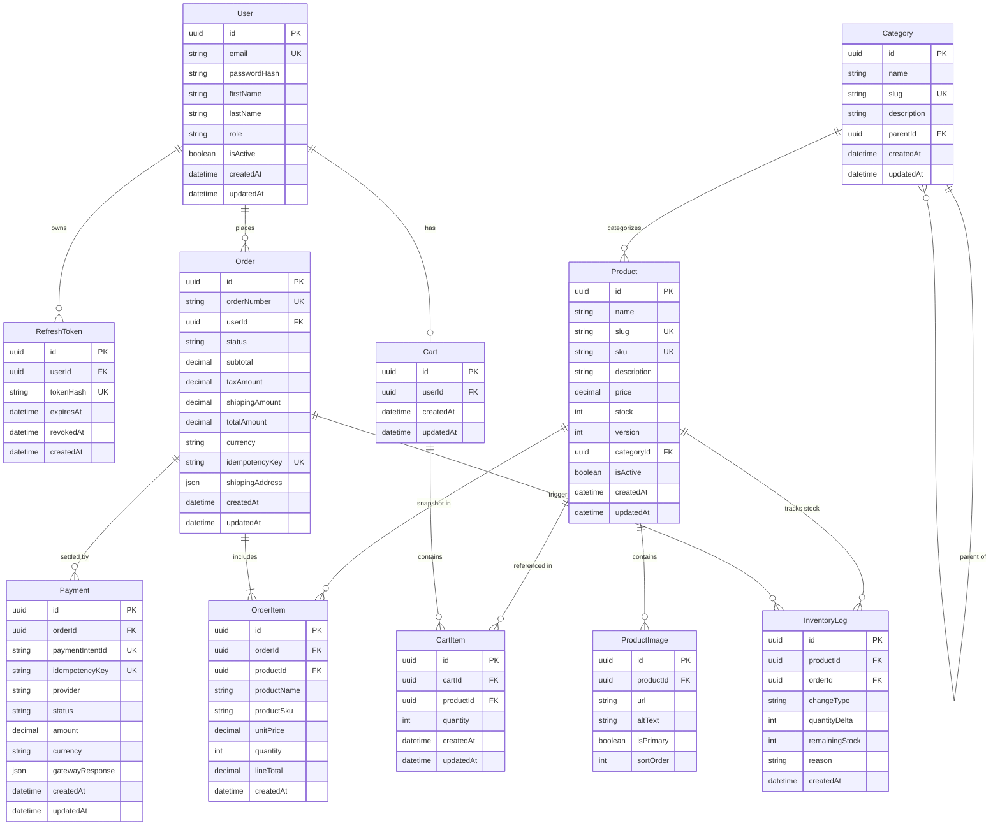

# QuickCart Data Entities, Relationships & Schema Specification

## 1. Entity Relationship Diagram (ERD)



---

## 2. Data Dictionary & Detailed Entity Specifications

### 2.1 User (`User`)
Stores customer accounts, authentication credentials, and role-based authorization identities.
- `id` (UUID, PK, Default: `gen_random_uuid()`): Unique identifier.
- `email` (VarChar(255), Unique, Not Null): Lowercase normalized email. B-tree indexed.
- `passwordHash` (VarChar(255), Not Null): Salted bcrypt hash (cost factor 12).
- `firstName` (VarChar(100), Not Null).
- `lastName` (VarChar(100), Not Null).
- `role` (Enum: `CUSTOMER`, `ADMIN`, Not Null, Default: `CUSTOMER`).
- `isActive` (Boolean, Default: `true`): Allows soft deactivation/suspension.
- `createdAt`, `updatedAt` (Timestamp with time zone).

### 2.2 Refresh Token (`RefreshToken`)
Implements secure Refresh Token Rotation (RTR). Storing tokens in the database enables immediate token revocation.
- `id` (UUID, PK).
- `userId` (UUID, FK -> `User.id`, `ON DELETE CASCADE`).
- `tokenHash` (VarChar(255), Unique, Not Null): SHA-256 hash of the cryptographically random token string.
- `expiresAt` (Timestamp with time zone, Not Null).
- `revokedAt` (Timestamp with time zone, Nullable): Set to current timestamp when rotated or user logs out.
- `createdAt` (Timestamp with time zone).

### 2.3 Category (`Category`)
Supports nested hierarchical product taxonomies (e.g. *Electronics > Audio > Headphones*).
- `id` (UUID, PK).
- `name` (VarChar(100), Not Null).
- `slug` (VarChar(120), Unique, Not Null): URL-safe identifier (e.g., `smartphones`).
- `description` (Text, Nullable).
- `parentId` (UUID, FK -> `Category.id`, `ON DELETE SET NULL`, Nullable): Enables self-referencing tree structure.
- `createdAt`, `updatedAt` (Timestamp with time zone).

### 2.4 Product (`Product`)
Core catalog item entity.
- `id` (UUID, PK).
- `name` (VarChar(255), Not Null).
- `slug` (VarChar(280), Unique, Not Null): SEO-friendly slug.
- `sku` (VarChar(50), Unique, Not Null): Stock Keeping Unit.
- `description` (Text, Not Null).
- `price` (Decimal(10, 2), Not Null): Stored as PostgreSQL `NUMERIC(10, 2)` to eliminate floating-point precision loss.
- `stock` (Integer, Not Null, Default: 0): Current quantity available for purchase.
- `version` (Integer, Default: 1): Version counter for Optimistic Concurrency Control during admin catalog updates.
- `categoryId` (UUID, FK -> `Category.id`, `ON DELETE RESTRICT`).
- `isActive` (Boolean, Default: `true`): Hides discontinued products without breaking historical order references.
- `createdAt`, `updatedAt` (Timestamp with time zone).

### 2.5 Product Image (`ProductImage`)
- `id` (UUID, PK).
- `productId` (UUID, FK -> `Product.id`, `ON DELETE CASCADE`).
- `url` (Text, Not Null): Asset URL.
- `altText` (VarChar(255), Nullable).
- `isPrimary` (Boolean, Default: `false`).
- `sortOrder` (Integer, Default: 0).

### 2.6 Shopping Cart & Cart Item (`Cart`, `CartItem`)
Designed with **Server-Side Price Authority**.
- Notice: The `CartItem` table intentionally does **not** store a `price` field. The shopping cart stores only `productId` and `quantity`. Prices are always looked up from the authoritative `Product` table when rendering the cart or computing order totals.
- `CartItem` contains a composite unique constraint: `@@unique([cartId, productId])`, preventing duplicate rows for the same product in a single cart.

### 2.7 Order (`Order`)
Represents an immutable commercial agreement.
- `id` (UUID, PK).
- `orderNumber` (VarChar(32), Unique, Not Null): Human-readable public reference (e.g., `ORD-20261023-9F8A`).
- `userId` (UUID, FK -> `User.id`, `ON DELETE RESTRICT`).
- `status` (Enum: `PENDING_PAYMENT`, `PAID`, `PROCESSING`, `SHIPPED`, `DELIVERED`, `CANCELLED`, `EXPIRED`, `REFUNDED`).
- `subtotal` (Decimal(10, 2), Not Null).
- `taxAmount` (Decimal(10, 2), Default: 0.00).
- `shippingAmount` (Decimal(10, 2), Default: 0.00).
- `totalAmount` (Decimal(10, 2), Not Null).
- `currency` (VarChar(3), Default: 'USD').
- `idempotencyKey` (VarChar(64), Unique, Nullable): Ensures safe network retries.
- `shippingAddress` (JSONB, Not Null): Immutable snapshot of destination address at purchase time.
- `createdAt`, `updatedAt` (Timestamp with time zone).

### 2.8 Order Item (`OrderItem`)
An immutable financial and physical snapshot.
- Crucial Design Rule: `OrderItem` stores the `unitPrice` and `lineTotal` as a **frozen snapshot** at the exact millisecond the order was placed. If the merchant changes product pricing tomorrow, existing historical orders remain completely unchanged.
- `id` (UUID, PK).
- `orderId` (UUID, FK -> `Order.id`, `ON DELETE CASCADE`).
- `productId` (UUID, FK -> `Product.id`, `ON DELETE RESTRICT`).
- `productName` (VarChar(255), Not Null): Preserves product name even if renamed later.
- `productSku` (VarChar(50), Not Null).
- `unitPrice` (Decimal(10, 2), Not Null).
- `quantity` (Integer, Not Null).
- `lineTotal` (Decimal(10, 2), Not Null): `unitPrice * quantity`.

### 2.9 Payment (`Payment`)
Tracks simulated payment gateway attempts and outcomes.
- `id` (UUID, PK).
- `orderId` (UUID, FK -> `Order.id`, `ON DELETE RESTRICT`).
- `paymentIntentId` (VarChar(100), Unique, Not Null): Simulated gateway reference ID.
- `idempotencyKey` (VarChar(64), Unique, Not Null).
- `provider` (VarChar(50), Default: 'SIMULATED_GATEWAY').
- `status` (Enum: `INITIATED`, `SUCCEEDED`, `FAILED`, `REFUNDED`).
- `amount` (Decimal(10, 2), Not Null).
- `gatewayResponse` (JSONB, Nullable): Full raw webhook/response payload for auditability.
- `createdAt`, `updatedAt` (Timestamp with time zone).

### 2.10 Inventory Audit Log (`InventoryLog`)
Audit trail for every stock movement.
- `id` (UUID, PK).
- `productId` (UUID, FK -> `Product.id`).
- `orderId` (UUID, FK -> `Order.id`, Nullable).
- `changeType` (Enum: `CHECKOUT_RESERVATION`, `EXPIRATION_RELEASE`, `MANUAL_ADJUSTMENT`, `CANCELLATION_RESTOCK`).
- `quantityDelta` (Integer, Not Null): Negative for deductions, positive for restorations.
- `remainingStock` (Integer, Not Null): Snapshot of stock after the operation.
- `reason` (VarChar(255), Nullable).
- `createdAt` (Timestamp with time zone).

---

## 3. Database Indexes & Optimization Rationale

| Table | Index Columns | Index Type | Engineering Purpose |
| :--- | :--- | :--- | :--- |
| `Product` | `slug` | B-tree (Unique) | O(1) product lookup by URL slug |
| `Product` | `sku` | B-tree (Unique) | Fast warehouse/barcode lookup |
| `Product` | `categoryId`, `price` | B-tree (Compound) | Accelerates category filtering sorted by price |
| `Product` | `name`, `description` | PostgreSQL GIN / Trigram | Full-text search and partial matching |
| `Order` | `userId`, `createdAt` | B-tree (Compound) | Fast pagination of user order history |
| `Order` | `idempotencyKey` | B-tree (Unique) | Rapid idempotency verification |
| `Order` | `status` | B-tree | Accelerated background worker queries |
| `CartItem` | `cartId`, `productId` | B-tree (Unique) | Prevents duplicate cart line items |

---

## 4. Prisma Schema Blueprint (`prisma/schema.prisma`)

```prisma
datasource db {
  provider = "postgresql"
  url      = env("DATABASE_URL")
}

generator client {
  provider = "prisma-client-js"
}

enum Role {
  CUSTOMER
  ADMIN
}

enum OrderStatus {
  PENDING_PAYMENT
  PAID
  PROCESSING
  SHIPPED
  DELIVERED
  CANCELLED
  EXPIRED
  REFUNDED
}

enum PaymentStatus {
  INITIATED
  SUCCEEDED
  FAILED
  REFUNDED
}

enum InventoryChangeType {
  CHECKOUT_RESERVATION
  EXPIRATION_RELEASE
  MANUAL_ADJUSTMENT
  CANCELLATION_RESTOCK
}

model User {
  id            String         @id @default(uuid()) @db.Uuid
  email         String         @unique @db.VarChar(255)
  passwordHash  String         @db.VarChar(255)
  firstName     String         @db.VarChar(100)
  lastName      String         @db.VarChar(100)
  role          Role           @default(CUSTOMER)
  isActive      Boolean        @default(true)
  createdAt     DateTime       @default(now()) @db.Timestamptz(6)
  updatedAt     DateTime       @updatedAt @db.Timestamptz(6)
  
  refreshTokens RefreshToken[]
  orders        Order[]
  cart          Cart?

  @@index([email])
}

model RefreshToken {
  id        String    @id @default(uuid()) @db.Uuid
  userId    String    @db.Uuid
  tokenHash String    @unique @db.VarChar(255)
  expiresAt DateTime  @db.Timestamptz(6)
  revokedAt DateTime? @db.Timestamptz(6)
  createdAt DateTime  @default(now()) @db.Timestamptz(6)

  user      User      @relation(fields: [userId], references: [id], onDelete: Cascade)

  @@index([userId])
  @@index([tokenHash])
}

model Category {
  id          String     @id @default(uuid()) @db.Uuid
  name        String     @db.VarChar(100)
  slug        String     @unique @db.VarChar(120)
  description String?    @db.Text
  parentId    String?    @db.Uuid
  createdAt   DateTime   @default(now()) @db.Timestamptz(6)
  updatedAt   DateTime   @updatedAt @db.Timestamptz(6)

  parent      Category?  @relation("SubCategories", fields: [parentId], references: [id], onDelete: SetNull)
  children    Category[] @relation("SubCategories")
  products    Product[]

  @@index([slug])
}

model Product {
  id          String         @id @default(uuid()) @db.Uuid
  name        String         @db.VarChar(255)
  slug        String         @unique @db.VarChar(280)
  sku         String         @unique @db.VarChar(50)
  description String         @db.Text
  price       Decimal        @db.Decimal(10, 2)
  stock       Int            @default(0)
  version     Int            @default(1)
  categoryId  String         @db.Uuid
  isActive    Boolean        @default(true)
  createdAt   DateTime       @default(now()) @db.Timestamptz(6)
  updatedAt   DateTime       @updatedAt @db.Timestamptz(6)

  category    Category       @relation(fields: [categoryId], references: [id], onDelete: Restrict)
  images      ProductImage[]
  cartItems   CartItem[]
  orderItems  OrderItem[]
  inventoryLogs InventoryLog[]

  @@index([categoryId, price])
  @@index([slug])
  @@index([sku])
}

model ProductImage {
  id        String   @id @default(uuid()) @db.Uuid
  productId String   @db.Uuid
  url       String   @db.Text
  altText   String?  @db.VarChar(255)
  isPrimary Boolean  @default(false)
  sortOrder Int      @default(0)

  product   Product  @relation(fields: [productId], references: [id], onDelete: Cascade)

  @@index([productId])
}

model Cart {
  id        String     @id @default(uuid()) @db.Uuid
  userId    String     @unique @db.Uuid
  createdAt DateTime   @default(now()) @db.Timestamptz(6)
  updatedAt DateTime   @updatedAt @db.Timestamptz(6)

  user      User       @relation(fields: [userId], references: [id], onDelete: Cascade)
  items     CartItem[]
}

model CartItem {
  id        String   @id @default(uuid()) @db.Uuid
  cartId    String   @db.Uuid
  productId String   @db.Uuid
  quantity  Int      @default(1)
  createdAt DateTime @default(now()) @db.Timestamptz(6)
  updatedAt DateTime @updatedAt @db.Timestamptz(6)

  cart      Cart     @relation(fields: [cartId], references: [id], onDelete: Cascade)
  product   Product  @relation(fields: [productId], references: [id], onDelete: Restrict)

  @@unique([cartId, productId])
  @@index([cartId])
}

model Order {
  id             String         @id @default(uuid()) @db.Uuid
  orderNumber    String         @unique @db.VarChar(32)
  userId         String         @db.Uuid
  status         OrderStatus    @default(PENDING_PAYMENT)
  subtotal       Decimal        @db.Decimal(10, 2)
  taxAmount      Decimal        @default(0.00) @db.Decimal(10, 2)
  shippingAmount Decimal        @default(0.00) @db.Decimal(10, 2)
  totalAmount    Decimal        @db.Decimal(10, 2)
  currency       String         @default("USD") @db.VarChar(3)
  idempotencyKey String?        @unique @db.VarChar(64)
  shippingAddress Json          @db.JsonB
  createdAt      DateTime       @default(now()) @db.Timestamptz(6)
  updatedAt      DateTime       @updatedAt @db.Timestamptz(6)

  user           User           @relation(fields: [userId], references: [id], onDelete: Restrict)
  items          OrderItem[]
  payments       Payment[]
  inventoryLogs  InventoryLog[]

  @@index([userId, createdAt])
  @@index([status])
  @@index([orderNumber])
}

model OrderItem {
  id          String   @id @default(uuid()) @db.Uuid
  orderId     String   @db.Uuid
  productId   String   @db.Uuid
  productName String   @db.VarChar(255)
  productSku  String   @db.VarChar(50)
  unitPrice   Decimal  @db.Decimal(10, 2)
  quantity    Int
  lineTotal   Decimal  @db.Decimal(10, 2)
  createdAt   DateTime @default(now()) @db.Timestamptz(6)

  order       Order    @relation(fields: [orderId], references: [id], onDelete: Cascade)
  product     Product  @relation(fields: [productId], references: [id], onDelete: Restrict)

  @@index([orderId])
}

model Payment {
  id              String        @id @default(uuid()) @db.Uuid
  orderId         String        @db.Uuid
  paymentIntentId String        @unique @db.VarChar(100)
  idempotencyKey  String        @unique @db.VarChar(64)
  provider        String        @default("SIMULATED_GATEWAY") @db.VarChar(50)
  status          PaymentStatus @default(INITIATED)
  amount          Decimal       @db.Decimal(10, 2)
  currency        String        @default("USD") @db.VarChar(3)
  gatewayResponse Json?         @db.JsonB
  createdAt       DateTime      @default(now()) @db.Timestamptz(6)
  updatedAt       DateTime      @updatedAt @db.Timestamptz(6)

  order           Order         @relation(fields: [orderId], references: [id], onDelete: Restrict)

  @@index([orderId])
}

model InventoryLog {
  id            String              @id @default(uuid()) @db.Uuid
  productId     String              @db.Uuid
  orderId       String?             @db.Uuid
  changeType    InventoryChangeType
  quantityDelta Int
  remainingStock Int
  reason        String?             @db.VarChar(255)
  createdAt     DateTime            @default(now()) @db.Timestamptz(6)

  product       Product             @relation(fields: [productId], references: [id], onDelete: Restrict)
  order         Order?              @relation(fields: [orderId], references: [id], onDelete: SetNull)

  @@index([productId, createdAt])
}
```
