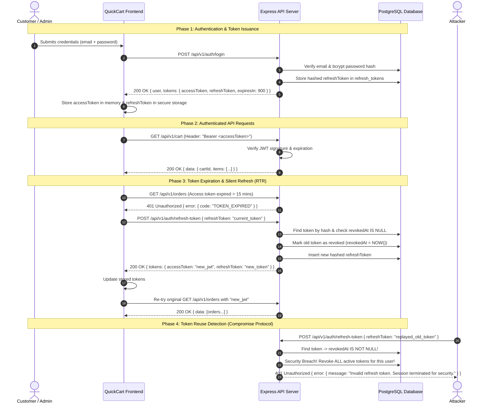

# QuickCart — Frontend Authentication & Token Lifecycle Architecture

This document specifies the exact authentication lifecycle, token rotation mechanics, reuse detection protocol, and HTTP interceptor architecture required for the QuickCart frontend application.

---

## 🔐 1. Authentication Mechanics & Token Types

QuickCart implements a **Dual-Token Architecture**:

| Token Type | Medium | Lifespan | Storage / State | Purpose |
| :--- | :--- | :--- | :--- | :--- |
| **Access Token** | JWT (JSON Web Token) | **15 Minutes** (`15m`) | Stateless (Signed with `JWT_ACCESS_SECRET`) | Authorizes API requests via `Authorization: Bearer <token>` |
| **Refresh Token** | Cryptographic random hex string | **7 Days** (`7d`) | Stateful (SHA-256 hashed in PostgreSQL `refresh_tokens` table) | Obtains fresh token pairs without user re-authentication |

### Decoded Access Token Payload
The access token is a standard JWT signed with HS256 containing:
```json
{
  "id": "c1f7a6b2-8e12-4c6e-9310-8b1a2d5f6e80",
  "email": "customer@example.com",
  "role": "CUSTOMER", // or "ADMIN"
  "iat": 1731067200,
  "exp": 1731068100
}
```

---

## 🔄 2. Complete Authentication Flow Diagram



---

## 🛡️ 3. Security Requirements & Token Storage

### Storage Strategy
1. **Access Token (`accessToken`)**:
   - Store in **in-memory application state** (e.g., Zustand auth store or React Context).
   - *Rationale*: Memory storage prevents Cross-Site Scripting (XSS) scripts from extracting active authorization credentials from `localStorage`.
2. **Refresh Token (`refreshToken`)**:
   - In single-page applications without a backend-for-frontend (BFF) proxy, store in `localStorage` under `quickcart_refresh_token` or secure cookies.
   - Because the backend enforces **Refresh Token Rotation (RTR)** and **Reuse Detection**, any exfiltration attempt invalidates the entire token family automatically.

---

## ⚡ 4. Frontend Axios / Fetch Interceptor Implementation

To achieve seamless, transparent token refresh without interrupting user interactions, the frontend HTTP client must implement a mutexed request queue.

### Reference Interceptor Architecture (TypeScript)

```typescript
import axios, { AxiosError, InternalAxiosRequestConfig } from 'axios';

interface StoredTokens {
  accessToken: string | null;
  refreshToken: string | null;
}

let tokens: StoredTokens = {
  accessToken: null,
  refreshToken: typeof window !== 'undefined' ? localStorage.getItem('quickcart_refresh_token') : null,
};

export const setTokens = (accessToken: string | null, refreshToken: string | null) => {
  tokens.accessToken = accessToken;
  tokens.refreshToken = refreshToken;
  if (refreshToken) {
    localStorage.setItem('quickcart_refresh_token', refreshToken);
  } else {
    localStorage.removeItem('quickcart_refresh_token');
  }
};

export const apiClient = axios.create({
  baseURL: process.env.NEXT_PUBLIC_API_URL || 'http://localhost:5000/api/v1',
  headers: {
    'Content-Type': 'application/json',
  },
  withCredentials: true,
});

// Request Interceptor: Injects active Bearer Access Token
apiClient.interceptors.request.use((config: InternalAxiosRequestConfig) => {
  if (tokens.accessToken && !config.headers.Authorization) {
    config.headers.Authorization = `Bearer ${tokens.accessToken}`;
  }
  return config;
});

// Response Interceptor: Handles 401 TOKEN_EXPIRED with mutexed silent refresh
let isRefreshing = false;
let failedQueue: Array<{
  resolve: (value?: unknown) => void;
  reject: (reason?: unknown) => void;
}> = [];

const processQueue = (error: Error | null, token: string | null = null) => {
  failedQueue.forEach((promise) => {
    if (error) {
      promise.reject(error);
    } else {
      promise.resolve(token);
    }
  });
  failedQueue = [];
};

apiClient.interceptors.response.use(
  (response) => response,
  async (error: AxiosError<{ error?: { code?: string; message?: string } }>) => {
    const originalRequest = error.config as InternalAxiosRequestConfig & { _retry?: boolean };

    if (!error.response || !originalRequest) {
      return Promise.reject(error);
    }

    const statusCode = error.response.status;
    const errorCode = error.response.data?.error?.code;

    // Trigger refresh only on 401 with TOKEN_EXPIRED
    if (statusCode === 401 && errorCode === 'TOKEN_EXPIRED' && !originalRequest._retry) {
      if (isRefreshing) {
        // Enqueue concurrent requests while refresh is in-flight
        return new Promise((resolve, reject) => {
          failedQueue.push({ resolve, reject });
        })
          .then((newToken) => {
            originalRequest.headers.Authorization = `Bearer ${newToken}`;
            return apiClient(originalRequest);
          })
          .catch((err) => Promise.reject(err));
      }

      originalRequest._retry = true;
      isRefreshing = true;

      const currentRefreshToken = tokens.refreshToken;
      if (!currentRefreshToken) {
        setTokens(null, null);
        return Promise.reject(error);
      }

      try {
        const { data } = await axios.post(
          `${process.env.NEXT_PUBLIC_API_URL || 'http://localhost:5000/api/v1'}/auth/refresh-token`,
          { refreshToken: currentRefreshToken }
        );

        const newAccessToken = data.data.tokens.accessToken;
        const newRefreshToken = data.data.tokens.refreshToken;

        // Persist new rotated tokens
        setTokens(newAccessToken, newRefreshToken);

        // Process waiting queue
        processQueue(null, newAccessToken);

        // Re-execute original request
        originalRequest.headers.Authorization = `Bearer ${newAccessToken}`;
        return apiClient(originalRequest);
      } catch (refreshErr) {
        processQueue(refreshErr as Error, null);
        setTokens(null, null);
        // Dispatch global auth failure event to trigger login redirect
        if (typeof window !== 'undefined') {
          window.dispatchEvent(new CustomEvent('quickcart:unauthorized'));
        }
        return Promise.reject(refreshErr);
      } finally {
        isRefreshing = false;
      }
    }

    return Promise.reject(error);
  }
);
```

---

## 🚪 5. Logout & Session Termination

When the user clicks "Log out":
1. Dispatch `POST /api/v1/auth/logout` sending `{ refreshToken: tokens.refreshToken }` in the body along with the Bearer header.
2. The server marks the token as revoked in the database.
3. The frontend clears in-memory `accessToken`, removes `quickcart_refresh_token` from `localStorage`, and redirects to `/login`.
