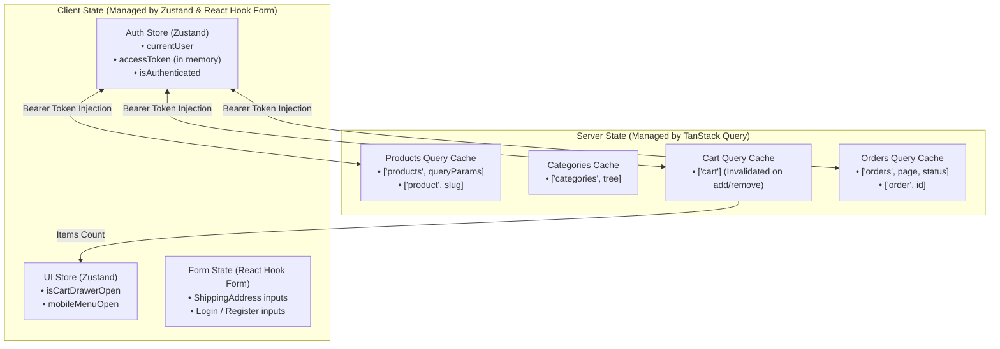

# QuickCart — Proposed Frontend Architecture & Design Blueprint

This document outlines the technical design, directory layout, state management strategy, routing hierarchy, and component architecture for the QuickCart frontend application located inside `/frontend`.

---

## 🏗️ 1. Recommended Technology Stack

| Layer | Technology | Version | Rationale |
| :--- | :--- | :--- | :--- |
| **Framework** | Next.js (App Router) | `14.x / 15.x` | Hybrid Server-Side Rendering (SSR), Static Site Generation (SSG), and client-side hydration with optimized image loading |
| **Language** | TypeScript | `5.x` (Strict) | Enforces end-to-end type safety matching backend Prisma schema and Zod contracts |
| **Styling** | Tailwind CSS | `3.4.x` | Utility-first, responsive, and zero-runtime CSS |
| **Icons** | Lucide React | `0.400+` | Lightweight, accessible SVG icon library |
| **Server State** | TanStack React Query | `5.x` | Automatic cache management, polling, background refetching, and optimistic mutations |
| **Client State** | Zustand | `4.x` | Minimalist, boilerplate-free client state for authentication tokens and UI modals |
| **Form Handling** | React Hook Form + Zod | `7.x / 3.x` | High-performance, uncontrolled form state with client-side schema validation matching backend Zod rules |
| **HTTP Client** | Axios | `1.7.x` | Robust interceptor pipeline for automatic token refresh and request retries |

---

## 📁 2. Proposed Directory Structure (`/frontend`)

```
frontend/
├── docs/                               # Architecture, API contracts, and integration specs
│   ├── API_CONTRACT.md
│   ├── AUTH_FLOW.md
│   ├── FRONTEND_ARCHITECTURE.md
│   └── BACKEND_INTEGRATION_NOTES.md
├── public/                             # Static assets, favicon, SVGs
├── src/
│   ├── app/                            # Next.js App Router route hierarchy
│   │   ├── (auth)/                     # Unauthenticated auth routes
│   │   │   ├── login/page.tsx
│   │   │   └── register/page.tsx
│   │   ├── (shop)/                     # Public shopping catalog
│   │   │   ├── page.tsx                # Homepage / Featured products
│   │   │   ├── products/
│   │   │   │   ├── page.tsx            # Catalog listing with search/filter/sort
│   │   │   │   └── [slug]/page.tsx     # Single product detail view
│   │   │   └── cart/page.tsx           # Shopping cart view
│   │   ├── (checkout)/                 # Protected checkout & payment flows
│   │   │   ├── checkout/page.tsx       # Shipping address & order confirmation
│   │   │   └── pay/[orderId]/page.tsx  # Simulated payment execution
│   │   ├── (account)/                  # Customer account portal
│   │   │   ├── orders/
│   │   │   │   ├── page.tsx            # Order history list
│   │   │   │   └── [id]/page.tsx       # Single order detail + status
│   │   │   └── profile/page.tsx        # User profile
│   │   ├── (admin)/                    # Admin-only dashboard
│   │   │   ├── admin/products/page.tsx # Product catalog management
│   │   │   └── admin/categories/page.tsx # Category management
│   │   ├── layout.tsx                  # Root layout (Providers, Navbar, Footer)
│   │   ├── not-found.tsx               # Custom 404 page
│   │   └── error.tsx                   # Global error boundary
│   ├── components/                     # Modular component library
│   │   ├── ui/                         # Atomic primitives (Button, Input, Modal, Badge)
│   │   ├── common/                     # Structural components (Navbar, Footer, CartDrawer)
│   │   ├── products/                   # ProductCard, ProductGrid, PriceFilter, Gallery
│   │   ├── cart/                       # CartItemRow, CartSummary, QuantitySelector
│   │   ├── checkout/                   # ShippingForm, OrderSummary, SimulationPicker
│   │   └── orders/                     # OrderCard, StatusBadge, ExpirationTimer
│   ├── hooks/                          # Custom React & React Query hooks
│   │   ├── useAuth.ts                  # Login, register, logout, me
│   │   ├── useCart.ts                  # Add, update, delete, clear cart
│   │   ├── useProducts.ts              # Catalog queries and admin mutations
│   │   ├── useOrders.ts                # Checkout, order list, order detail, cancel
│   │   └── usePayments.ts              # Pay order, fetch payment attempts
│   ├── lib/                            # Infrastructure and utilities
│   │   ├── api-client.ts               # Axios instance with interceptors
│   │   ├── query-client.ts             # React Query default options
│   │   ├── formatters.ts               # Currency and date formatting helpers
│   │   └── constants.ts                # Routes, error codes, and storage keys
│   ├── stores/                         # Zustand state stores
│   │   ├── auth-store.ts               # User session and access token
│   │   └── ui-store.ts                 # Cart drawer and modal visibility
│   └── types/                          # Shared TypeScript domain models
│       ├── api.ts                      # ApiResponse and ApiError types
│       ├── auth.ts                     # User, Token, and Auth credentials
│       ├── product.ts                  # Product, Image, and Category
│       ├── cart.ts                     # Cart and CartItem
│       ├── order.ts                    # Order, OrderItem, ShippingAddress
│       └── payment.ts                  # Payment and GatewayResponse
├── .env.local.example                  # Environment template
├── next.config.mjs                     # Next.js configuration (Image domains)
├── tailwind.config.ts                  # Tailwind configuration
├── tsconfig.json                       # TypeScript compiler settings
└── package.json                        # Frontend dependencies and scripts
```

---

## 🌐 3. State Management Division



---

## 🚦 4. Routing & Protection Strategy

| Route Path | Access Level | Behavior if Unauthorized |
| :--- | :--- | :--- |
| `/` | Public | Open to all visitors |
| `/products` | Public | Open to all visitors |
| `/products/[slug]` | Public | Open to all visitors |
| `/login` | Guest Only | Redirect to `/` or previously intended URL if already authenticated |
| `/register` | Guest Only | Redirect to `/` if already authenticated |
| `/cart` | Authenticated | Redirect to `/login?redirect=/cart` |
| `/checkout` | Authenticated | Redirect to `/login?redirect=/checkout` (or `/cart` if cart is empty) |
| `/pay/[orderId]` | Authenticated | Redirect to `/login` (Verify order ownership on server) |
| `/orders` | Authenticated | Redirect to `/login?redirect=/orders` |
| `/orders/[id]` | Authenticated | Redirect to `/login` |
| `/admin/*` | Admin Only | Redirect to `/` if `user.role !== 'ADMIN'` |

---

## 🎨 5. UI/UX & Accessibility Standards

1. **Responsive Breakpoints**:
   - Mobile: `< 640px` (Full-width drawers, single-column product cards, sticky bottom checkout bar).
   - Tablet: `640px - 1024px` (2-column grid, responsive table views).
   - Desktop: `> 1024px` (3/4-column product grid, sticky sidebar order summary).
2. **Zero Layout Shift (CLS)**:
   - Skeletons displayed during initial React Query fetching for product grids, cart items, and order details.
3. **Optimistic Updates**:
   - Cart item quantity increments update the UI immediately with rollback on server failure.
4. **Accessible Forms**:
   - WAI-ARIA compliant inputs with associated `<label>` elements, `aria-invalid`, and readable error messages.
